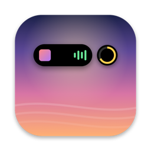
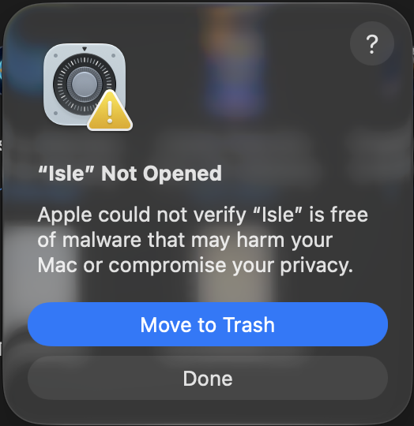

<p align="center"></p>

<h1 align="center">Isle</h1>

A small macOS app that turns the notch at the top of your screen into a handy little island. Hover over the notch (or press <kbd>⌃ Space</kbd>) to open it.

## Features

- **Home** — a motivational quote that changes every 5 minutes, what's playing (Spotify, Apple Music, Safari, YouTube and more) with playback controls, and CPU / GPU usage, temperature and memory pressure. The island always opens on Home.
- **Nepali date** — today's Bikram Sambat date (e.g. मंसिर ६) in the menu bar; click it for the weekday and full date.
- **Activity circles** — keep awake, a timer, downloads in progress and your next meeting each get a small circle beside the notch, so the notch itself keeps your music. Click a circle to open it.
- **Calendar** — today's events.
- **Timer** — quick countdowns with a progress ring.
- **Clipboard** — text clipboard history (skips password managers).
- **Shelf** — drop files on the island to hold them for later, or convert images to PDF, JPG, HEIC or PNG.
- **Notes** — a quick scratchpad.
- **Camera** — a mirror to check how you look before a call.
- **Keep awake** — stop your Mac from sleeping while the cup icon is on.

## Requirements

- macOS 14 or later
- A Mac with a notch works best; on other Macs the island sits at the top of the screen.
- Temperatures need Apple Silicon.

## Install

### Download

1. Download `Isle-0.1.zip` from the [Releases](../../releases) page.
2. Unzip it and move `Isle.app` to **Applications**.
3. Open Isle.

#### "Isle" Not Opened?

Isle isn't notarized by Apple (that needs a paid developer account), so the first time you open it macOS shows this:



This is expected. To open it anyway:

1. Click **Done** (not *Move to Trash*).
2. Open **System Settings → Privacy & Security** and scroll down to **Security**.
3. Next to **"Isle" was blocked to protect your Mac**, click **Open Anyway** and enter your password.
4. Open Isle again and click **Open**.

You only need to do this once.

<details>
<summary>Prefer Terminal?</summary>

Remove the "downloaded from the internet" flag, then open Isle normally:

```sh
xattr -dr com.apple.quarantine /Applications/Isle.app
```
</details>

### Build it yourself

Needs Xcode or the Xcode Command Line Tools (`xcode-select --install`).

Install or update with one command (run it again any time to get the latest version):

```sh
git clone https://github.com/yabeshlimbu/Isle.git ~/Isle 2>/dev/null || git -C ~/Isle pull; ~/Isle/build.sh install
```

It downloads Isle into `~/Isle` (or pulls the latest changes if it's already there), builds it, copies it to /Applications and launches it.

Or step by step:

```sh
git clone https://github.com/yabeshlimbu/Isle.git
cd Isle
./build.sh install    # builds, copies to /Applications and launches
```

`./build.sh` on its own just builds into `build/Isle.app`.

## Permissions

Isle asks for these only when you use the feature that needs them:

| Permission | Used for |
|---|---|
| Calendars | Showing today's events |
| Camera | The camera mirror |
| Downloads folder | Download progress circle |
| Automation (Music, Spotify) | Extra now-playing details and controls for those two apps |

## Things to know

- **Now playing** and **temperatures** use private macOS interfaces (`MediaRemote` and the HID thermal sensors). Apple doesn't document them, so a future macOS update could break them. If that happens Isle hides the missing info instead of crashing. This is also why Isle isn't on the Mac App Store.
- Temperatures show the **hottest** sensor, so they can read higher than apps that show an average. To see every sensor, run `swift tools/sensors.swift`.
- Nothing leaves your Mac except the request for quotes to ZenQuotes.

## Credits

Some quotes are provided by [ZenQuotes API](https://zenquotes.io/).

## License

[MIT](LICENSE)
